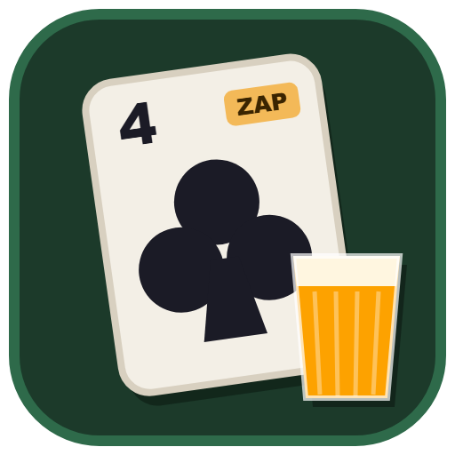

  

<h1 align="center">Trucado</h1>

  Um roguelike de deckbuilding no estilo <b>Balatro</b>, construído sobre as regras do <b>Truco Paulista</b>.

  
  

  <a href="https://github.com/BrenoNunesC/trucado/releases/latest"><b>⬇ Baixar a versão mais recente</b></a>

---

## O que é

Você enfrenta adversários (os **Blinds**) cada vez mais difíceis, precisa bater uma meta de pontos
com poucas mãos, ganha dinheiro, compra **Coringas** na loja e tenta chegar ao fim do **Ante 8**.
Cada mão é uma mão de truco de verdade contra a IA, e a pontuação segue a lógica do Balatro:
**Fichas × Mult**.

- 🃏 **Coringas** com efeitos próprios, alguns trancados até você cumprir uma condição.
- 🎴 **15 baralhos** inspirados no Balatro, adaptados ao Truco (Da Canga, Do Pagode, Batida, Maluco e outros).
- 🎨 **Temas visuais** das cartas: Clássico, Festa Junina, Carnaval e Noite de Bar.
- 🔥 **Chefes** que mudam as regras da mesa.
- 🌐 **Modo online**: 1 contra 1, duplas de 2 contra 2 e campanha em dupla, com chat e ranking.
- 🎲 **Seeds**: a mesma seed gera a mesma run.

## Como jogar

1. Escolha um baralho, uma stake (dificuldade) e comece a run.
2. Cada **Ante** tem três Blinds: Pequeno, Grande e Chefe. O Pequeno e o Grande podem ser pulados em troca de uma **Tag**.
3. Num Blind, você tem 4 mãos e 3 blefes para bater a meta. Vencer a mão pontua; perder não pontua.
4. Bateu a meta, vai para a **Loja**: compre Coringas, consumíveis, cartas e pacotes, e venda o que não precisa.
5. Vença o Chefe do Ante 8 para ganhar, e depois siga no modo infinito, se quiser.

Também há o **Modo livre** (truco clássico até 12, com Mão de Onze e Mão de Ferro) e um **Tutorial** de uma mão.

## Instalar (Windows)

Baixe a versão mais recente em [Releases](https://github.com/BrenoNunesC/trucado/releases/latest):

| Arquivo | Para quê |
| --- | --- |
| `Trucado-Instalador-x.y.z.exe` | instala no computador, com atalho na área de trabalho e no menu Iniciar. Atualiza sozinho |
| `Trucado-x.y.z-portatil.exe` | roda direto, sem instalar (dá para levar num pendrive). Não atualiza sozinho |

O Windows pode mostrar o aviso "O Windows protegeu o computador", porque o executável não tem assinatura
digital: clique em **Mais informações → Executar assim mesmo**.

## Documentação

- [**DESENVOLVIMENTO.md**](DESENVOLVIMENTO.md): como rodar o projeto, regras do Truco adotadas, pontuação,
  como criar Coringas, o modo online, o servidor e a publicação de versões.
- [**DESIGN.md**](DESIGN.md): arquitetura e decisões de design.

## Tecnologias

TypeScript, React, Vite, Electron e um servidor WebSocket em Node.js. Testes com Vitest.

---

  Feito com 🍺 e muito blefe.

